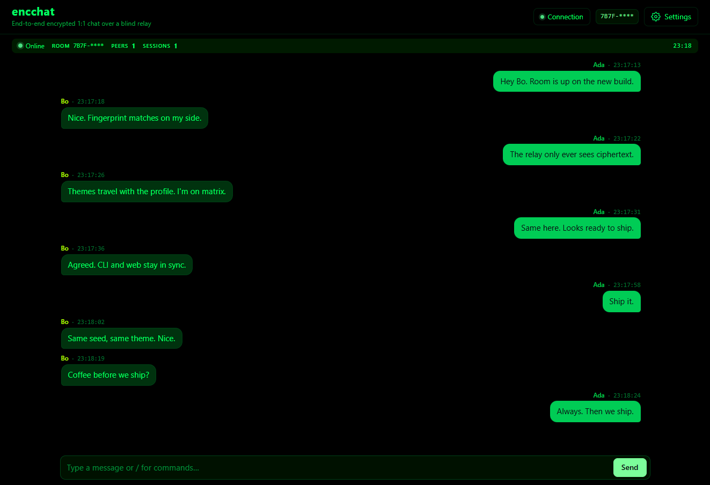
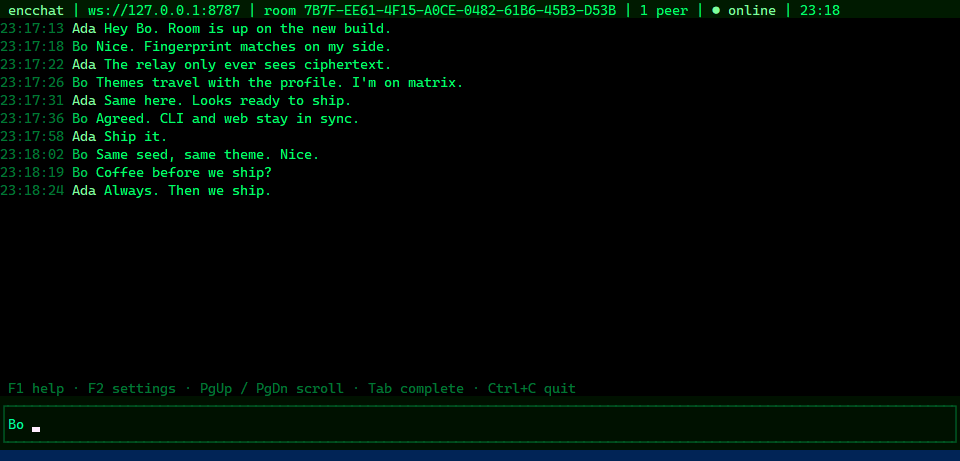

<div align="center">

**English** · [Türkçe](README.tr.md)

# encchat

### Self-hosted, end-to-end encrypted 1:1 chat over a blind relay.

**You share a key. The server never sees the conversation.**


[](LICENSE-MIT)
[](rust-toolchain.toml)
[](crates/wasm)
[](#quickstart)
[](docs/protocol.md)

**[Quickstart](#quickstart) · [Screenshots](#screenshots) · [How it works](#design-at-a-glance) · [Security](#security) · [Protocol](docs/protocol.md) · [Threat model](docs/threat-model.md)**

<code>cargo run -p encchat-cli -- keygen</code>

</div>

> [!IMPORTANT]
> The 24-word mnemonic **is** the key: anyone who has it can read the room.
> Exchange it in person or over an existing end-to-end encrypted channel, never
> over plaintext chat, SMS, or email.
>
> The web client is served by the same host that runs the relay. A malicious host
> could serve modified JavaScript that captures the mnemonic or plaintext; use the
> CLI when that matters. See [the threat model](docs/threat-model.md).

<a id="screenshots"></a>

<div align="center">

<br />

<table>
<tr>
<td align="center" width="50%">
  <a href="docs/screenshots/web.png">
    
  </a><br />
  <sub><strong>Web client</strong> · Matrix theme</sub>
</td>
<td align="center" width="50%">
  <a href="docs/screenshots/cli.png">
    
  </a><br />
  <sub><strong>CLI</strong> · Matrix theme</sub>
</td>
</tr>
</table>

<br />

</div>

---

Self-hosted, end-to-end encrypted 1:1 chat with an IRC feel: you join a room with
a key, talk, and leave. Nothing is stored by the server. Usable from a web app or
a CLI.

Two people share a 32-byte pre-shared key (PSK) out of band. The PSK is printed as
a 24-word BIP39 mnemonic so it can be read aloud. Everything else — room
derivation, handshake, message encryption, multi-device registration — follows
from that key.

Both clients run the same `encchat-core` and read the same portable appearance
profile; the Matrix preset in the screenshots is one of ten built-in themes.

**Status: working core, CLI, relay and web client.** The Rust core, the CLI
client, the relay server and the WASM-backed browser client build and pass their
tests, including an end-to-end test that runs two clients through a real relay.
Nothing here is audited or production-ready, and the on-disk/on-wire formats are
not frozen.

## Design at a glance

- **One crypto implementation, two frontends.** The Rust core (`encchat-core`,
  no I/O) is compiled to WASM for the browser and linked natively into the CLI.
- **The server is blind.** It relays WebSocket frames between devices in an
  opaque 16-byte room and holds a short-lived in-memory mailbox. It has no
  accounts, no disk storage, no message logs, and never sees the PSK.
- **Room ID.** `roomID = BLAKE2b-512("encchat/room/v1" || PSK)` truncated to 16
  bytes. The server learns only this 16-byte value, which is not invertible to the
  PSK.
- **Handshake.** Noise `XXpsk0` (X25519 / ChaChaPoly / BLAKE2s). The PSK
  authenticates both ends, so a malicious server cannot MITM the handshake. The
  handshake payload carries each side's initial Double Ratchet DH public key.
- **Messages.** Double Ratchet (X25519 DH ratchet, HKDF-SHA256, HMAC-SHA256 chain
  keys) with XChaCha20-Poly1305 AEAD, ratchet header as AAD. Forward secrecy and
  post-compromise security, plus skipped-message keys for out-of-order delivery.
- **Multi-device.** Each device has a random 16-byte device ID and its own ratchet
  session per peer device. Devices register with a MAC under the PSK
  (`HMAC-SHA256(PSK, ...)`), so the server cannot inject a device. Sends fan out
  one ciphertext per recipient device.
- **Local storage.** History and ratchet state are encrypted at rest with
  XChaCha20-Poly1305; the key comes from a passphrase via Argon2id (the CLI may use
  the OS keychain instead).

## Architecture

```
        out of band: 32-byte PSK  ==  24-word BIP39 mnemonic
        (in person, or over an existing E2EE channel)
             |                                        |
             v                                        v
  +----------------------+                 +----------------------+
  | CLI device           |                 | Web device           |
  | encchat-cli          |                 | browser              |
  |   encchat-core       |                 |   encchat-wasm       |
  |   ratchet sessions   |                 |   (same core)        |
  |   encrypted history  |                 |   encrypted local    |
  |   passphrase/keychain|                 |   state + passphrase |
  +----------+-----------+                 +----------+-----------+
             |                                        |
             |   WebSocket: Noise transport frames,   |
             |   then ratchet ciphertexts only        |
             +------------------+---------------------+
                                v
                 +-------------------------------+
                 | encchat-server                |
                 | blind WebSocket relay         |
                 | room = BLAKE2b-128(PSK)       |
                 | in-memory TTL mailbox         |
                 | no disk / accounts / history  |
                 +-------------------------------+
```

## Repository layout

| Path | Contents |
| --- | --- |
| `crates/core` | `encchat-core` — crypto and protocol primitives, no I/O |
| `crates/server` | `encchat-server` — blind WebSocket relay and TTL mailbox |
| `crates/cli` | `encchat-cli` — terminal client (native core) |
| `crates/wasm` | `encchat-wasm` — `wasm-bindgen` wrapper around the core |
| `crates/appearance` | Portable themes, layout, labels and timestamp settings |
| `web/` | TypeScript web UI |
| `docs/` | Threat model, ADRs, protocol notes, customization guides |

## Quickstart

Requires a stable Rust toolchain (see `rust-toolchain.toml`) and, for the web UI,
Node.js with npm.

Generate an identity. Write the 24 words down; they *are* the key:

```sh
cargo run -p encchat-cli -- keygen
```

Derive the room ID from a mnemonic:

```sh
cargo run -p encchat-cli -- room "<24 words>"
```

Start the relay (in one terminal):

```sh
cargo run -p encchat-server
# listening on 127.0.0.1:8787; see --help for bind, mailbox TTL/size, payload cap
```

Chat (in two terminals, using the same mnemonic). On first run each client asks
for a passphrase that encrypts its local state:

```sh
cargo run -p encchat-cli -- chat --server ws://127.0.0.1:8787 --mnemonic "<24 words>"
```

This opens an IRC-style full-screen client: a scrollback with timestamps, a
status bar, and a persistent input line at the bottom. Messages appear as
`<nick> body` once a peer announces a nickname (set yours with `--nick` or
`/nick`), and fall back to the peer's short device id otherwise. Long lines wrap,
per-peer colors distinguish devices, and reading older messages no longer yanks
you back to the bottom when something new arrives.

Slash commands: `/help`, `/quit`, `/clear`, `/nick <name>`, `/who`, `/status`,
`/fingerprint`, `/me <action>`, `/settings`, `/theme`, `/timestamps`, `/keys`,
and `/config`. `Up`/`Down` recall input history, `PageUp`/`PageDown` scroll,
`Tab` completes commands, and F1–F4 cover help, settings, timestamps, and themes.

Use `--plain` (or run with stdout redirected) for the simple line-based mode,
which is what the smoke test uses.

### Web client

```sh
cd web
npm.cmd install
npm.cmd run build:wasm   # after a fresh clone or a WASM change
npm.cmd run dev
```

The web client accepts either the 24-word mnemonic or the same 32 bytes written
as 64 hex characters; pasting a hex key connects immediately. The room
fingerprint stays masked (`8369-****`) until you hover or focus it, and clicking
it copies the full value.

> [!NOTE]
> On Windows use `npm.cmd` rather than `npm`. PowerShell resolves `npm` to
> `npm.ps1`, which is commonly blocked by the default execution policy
> (`running scripts is disabled on this system`).

Run the test suite (core, relay, CLI, plus the end-to-end WebSocket test):

```sh
cargo test
```

## Customization

The full-screen client is configurable without editing the binary: colors,
layout, status-bar contents, timestamps, behavior, prompt, and key bindings.
Open the in-terminal customizer with a live chat preview:

```sh
cargo run -p encchat-cli -- settings    # or press F2 inside a chat
```

Everything can also be changed non-interactively:

```sh
cargo run -p encchat-cli -- config keys
cargo run -p encchat-cli -- config set theme.preset dracula
cargo run -p encchat-cli -- config set layout.status_position bottom
cargo run -p encchat-cli -- config set keys.quit ctrl+q
cargo run -p encchat-cli -- config show
```

The web client has the same idea at `#/settings` (the gear in the header): a
live preview, themes and per-color overrides, typography, bubble or IRC layout,
density, timestamps, labels, and local peer aliases. Settings are stored in
`localStorage` and can be exported or imported as JSON.

The appearance profile is portable between the two clients:

```sh
cargo run -p encchat-cli -- config export-appearance ./appearance.json
cargo run -p encchat-cli -- config import-appearance ./appearance.json
```

The shared document is defined by `encchat-appearance`; it deliberately contains
no keys, mnemonics, server URLs or nicknames. CLI-only fields such as key
bindings and the prompt template stay in `config.json`.

Settings are stored in the OS config directory (for example,
`~/.config/encchat/config.json` or `%APPDATA%\encchat\config.json`), overridable
with `--config PATH` or `ENCCHAT_CONFIG`. Use `--theme <name>` to preview a
built-in theme for one session, or `/theme` to cycle one inside a chat.

The customizer, the full setting reference, theme presets, color formats,
key-binding syntax, and recipes are documented in
[docs/customization.md](docs/customization.md). The web settings page and the
portable profile are covered in
[docs/web-customization.md](docs/web-customization.md). Invalid values and
hand-edited files are validated and repaired at load time, and saves are atomic.

## Security

Read [docs/threat-model.md](docs/threat-model.md) before trusting this with
anything that matters. Two points belong in the summary:

1. **The web app can be backdoored by the host that serves it.** A malicious or
   compromised server can serve modified JavaScript that exfiltrates the PSK on
   entry, no matter how strong the cryptography below it is. Mitigations are
   pinned or reproducible builds, code signing, or using the CLI — the CLI has no
   such weakness. There is no way to verify in-browser that the JavaScript you
   loaded is the JavaScript that was audited.
2. **PSK distribution is the weak link.** If the 24 words ever travel over a
   plaintext channel (chat, SMS, email, a screenshot in a ticket), the scheme is
   broken. Exchange them in person or over an existing end-to-end encrypted
   channel.

The server is assumed hostile. It sees room IDs, device IDs, message sizes, and
timing; it cannot read message contents, forge a peer's identity, or complete a
MITM handshake.

## FAQ

<details>
<summary><strong>Do I need an account or a phone number?</strong></summary>

No. Identity is a 32-byte pre-shared key that two people exchange out of band.
There is no registration, no directory, and no server-side profile.

</details>

<details>
<summary><strong>Does the relay store my messages?</strong></summary>

Only as opaque ciphertext in an in-memory mailbox for devices that are briefly
offline. It has no disk storage, no accounts, and no message logs, and it expires
queued messages after a TTL. The relay cannot read any payload.

</details>

<details>
<summary><strong>Can more than two people join a room?</strong></summary>

No. v1 is strictly 1:1. One person may use several devices; each device gets its
own ratchet session and sends fan out one ciphertext per recipient device.

</details>

<details>
<summary><strong>What happens if I lose the 24 words?</strong></summary>

The room is gone. There is no account recovery, no escrow, and no server-side
backup. A leaked key cannot be revoked either: the only remedy is a new key and a
new room.

</details>

<details>
<summary><strong>Is this audited?</strong></summary>

No. The core composes well-reviewed primitives (Noise, X25519, XChaCha20-
Poly1305, Argon2id, BIP39) and has unit and end-to-end tests, but the composition
and the on-disk/on-wire formats are not audited or frozen. Read the
[threat model](docs/threat-model.md) first.

</details>

<details>
<summary><strong>Can I self-host the relay?</strong></summary>

Yes. `encchat-server` is a single small binary: a blind WebSocket relay with an
in-memory TTL mailbox and no database. Pick a bind address and put it behind your
own TLS terminator for `wss://`.

</details>

## Documentation

- [Protocol specification](docs/protocol.md): frames, handshake, ratchet, storage.
- [Threat model](docs/threat-model.md): what is protected, what leaks, residual risks.
- [Architecture decision record](docs/adr/0001-architecture.md): why one Rust core serves both clients.
- [CLI customization](docs/customization.md): settings, themes, key bindings, recipes.
- [Web customization](docs/web-customization.md): the settings page and portable profiles.
- [TODO](TODO.md): planned work and known limitations.

## What is deliberately not here yet

- Hiding metadata from the server: room ID, device IDs, message sizes, and
  timing are all visible to it.
- Group chats (v1 is strictly 1:1).
- Federation between servers.
- File transfer, images, voice, or video calls.
- Cross-device history sync — each device keeps its own encrypted history.
- Audits, fuzzing at scale, and a stable on-disk or on-wire format.
- Multi-user presence, typing indicators, or delivery receipts beyond what the
  protocol needs.

See [`TODO.md`](TODO.md) for the fuller, grouped list of planned work and known
limitations.

## Contributing

Issues and pull requests are welcome. Before sending a change, run the one-shot
check (`powershell -ExecutionPolicy Bypass -File scripts/check.ps1`, or the
`cargo`/`npm` commands above) and read [AGENTS.md](AGENTS.md) for the invariants
that must hold, especially that `encchat-core` stays free of I/O and that the
relay never parses payloads.

## License

Licensed under either of

- Apache License, Version 2.0 ([LICENSE-APACHE](LICENSE-APACHE))
- MIT license ([LICENSE-MIT](LICENSE-MIT))

at your option. Unless you explicitly state otherwise, any contribution
intentionally submitted for inclusion in this project, as defined in the Apache
2.0 license, shall be dual licensed as above, without any additional terms or
conditions.

> [!NOTE]
> This is a permissive license. Anyone may fork this project, modify the web
> client, host it, and share nothing back. Given that the server serves the
> JavaScript, that is a real limitation — see
> [docs/threat-model.md](docs/threat-model.md). If you later want hosted
> modifications to remain open, AGPL-3.0 is the license to consider.
