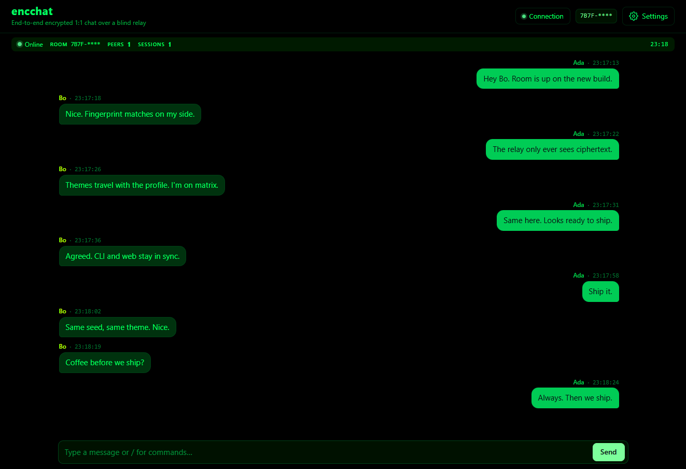
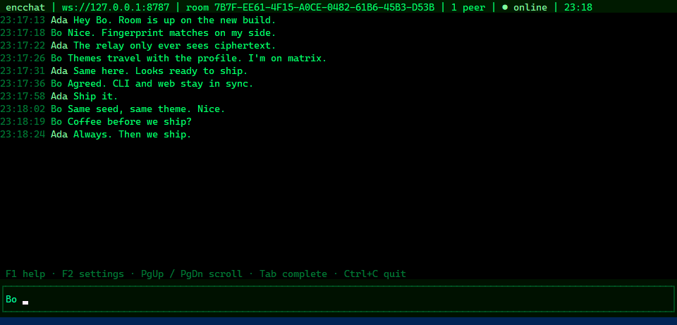

<div align="center">

[English](README.md) · **Türkçe**

# encchat

### Kendi sunucunuzda barındırılan, kör bir röle üzerinden uçtan uca şifreli 1:1 sohbet.

**Anahtarı siz paylaşırsınız. Sunucu sohbeti hiçbir zaman görmez.**

[](https://github.com/erdem-unal0/encchat/stargazers)
[](LICENSE-MIT)
[](rust-toolchain.toml)
[](crates/wasm)
[](#quickstart)
[](docs/protocol.md)

**[Hızlı başlangıç](#quickstart) · [Ekran görüntüleri](#screenshots) · [Nasıl çalışır](#design-at-a-glance) · [Güvenlik](#security) · [Protokol](docs/protocol.md) · [Tehdit modeli](docs/threat-model.md)**

<code>cargo run -p encchat-cli -- keygen</code>

</div>

> [!IMPORTANT]
> 24 kelimelik anımsatıcı **anahtarın ta kendisidir**: ona sahip olan herkes odayı
> okuyabilir. Onu yüz yüze ya da mevcut, uçtan uca şifreli bir kanal üzerinden
> paylaşın; düz metin sohbet, SMS veya e-posta üzerinden asla paylaşmayın.
>
> Web istemcisi, röleyi çalıştıran aynı ana makine tarafından sunulur. Kötü niyetli
> bir ana makine, anımsatıcıyı veya düz metni ele geçiren değiştirilmiş JavaScript
> sunabilir; bu sizin için önemliyse CLI'yi kullanın. Bkz.
> [tehdit modeli](docs/threat-model.md).

<a id="screenshots"></a>

<div align="center">

<br />

<table>
<tr>
<td align="center" width="50%">
  <a href="docs/screenshots/web.png">
    
  </a><br />
  <sub><strong>Web istemcisi</strong> · Matrix teması</sub>
</td>
<td align="center" width="50%">
  <a href="docs/screenshots/cli.png">
    
  </a><br />
  <sub><strong>CLI</strong> · Matrix teması</sub>
</td>
</tr>
</table>

<br />

</div>

---

Kendi sunucunuzda barındırılan, uçtan uca şifreli 1:1 sohbet — IRC hissiyle:
bir odaya anahtarıyla katılırsınız, konuşursunuz ve ayrılırsınız. Sunucu hiçbir şey
saklamaz. Web uygulamasından veya CLI'dan kullanılabilir.

İki kişi, 32 baytlık bir ön paylaşımlı anahtarı (PSK) bant dışı yolla paylaşır.
PSK, yüksek sesle okunabilsin diye 24 kelimelik bir BIP39 anımsatıcısı olarak
yazdırılır. Geri kalan her şey — oda türetimi, el sıkışma, mesaj şifreleme, çoklu
cihaz kaydı — bu anahtardan doğar.

Her iki istemci de aynı `encchat-core`'u çalıştırır ve aynı taşınabilir görünüm
profilini okur; ekran görüntülerindeki Matrix ön ayarı, on yerleşik temadan
biridir.

**Durum: çalışan çekirdek, CLI, röle ve web istemcisi.** Rust çekirdeği, CLI
istemcisi, röle sunucusu ve WASM destekli tarayıcı istemcisi derleniyor ve
testlerini geçiyor; iki istemciyi gerçek bir röle üzerinden çalıştıran uçtan uca
test de bunlara dahil. Buradaki hiçbir şey denetlenmedi ve hiçbir şey üretime hazır
değil; diskteki ve tel üzerindeki biçimler de dondurulmadı.

<a id="design-at-a-glance"></a>

## Bir bakışta tasarım

- **Tek bir kripto uygulaması, iki ön yüz.** Rust çekirdeği (`encchat-core`,
  G/Ç yok) tarayıcı için WASM'a derlenir ve CLI'ya yerel olarak bağlanır.
- **Sunucu kördür.** Cihazlar arasında WebSocket karelerini opak 16 baytlık bir
  oda içinde aktarır ve kısa ömürlü, bellekte tutulan bir posta kutusu barındırır.
  Hesabı, disk depolaması ve mesaj günlüğü yoktur; PSK'yı hiçbir zaman görmez.
- **Oda kimliği.** `roomID = BLAKE2b-512("encchat/room/v1" || PSK)` 16 bayta
  kısaltılır. Sunucu yalnızca bu 16 baytlık değeri öğrenir; bu değerden PSK'ya geri
  dönülemez.
- **El sıkışma.** Noise `XXpsk0` (X25519 / ChaChaPoly / BLAKE2s). PSK her iki ucu
  da doğrular, böylece kötü niyetli bir sunucu el sıkışmaya MITM yapamaz. El
  sıkışma yükü, her iki tarafın başlangıç Double Ratchet DH açık anahtarını taşır.
- **Mesajlar.** Double Ratchet (X25519 DH ratchet, HKDF-SHA256, HMAC-SHA256 zincir
  anahtarları) ve XChaCha20-Poly1305 AEAD; ratchet başlığı AAD olarak kullanılır.
  İleriye dönük gizlilik ve ele geçirme sonrası güvenlik; ayrıca sıra dışı teslimat
  için atlanmış mesaj anahtarları.
- **Çoklu cihaz.** Her cihazın rastgele 16 baytlık bir cihaz kimliği ve eş cihaz
  başına kendi ratchet oturumu vardır. Cihazlar PSK altında bir MAC ile kaydolur
  (`HMAC-SHA256(PSK, ...)`), böylece sunucu araya cihaz sokamaz. Gönderimler,
  alıcı cihaz başına bir şifreli metin olacak şekilde dağıtılır.
- **Yerel depolama.** Geçmiş ve ratchet durumu, XChaCha20-Poly1305 ile diskte
  şifreli tutulur; anahtar bir paroladan Argon2id ile gelir (CLI bunun yerine
  işletim sistemi anahtar zincirini kullanabilir).

## Mimari

```
        out of band: 32-byte PSK  ==  24-word BIP39 mnemonic
        (in person, or over an existing E2EE channel)
             |                                        |
             v                                        v
  +----------------------+                 +----------------------+
  | CLI device           |                 | Web device           |
  | encchat-cli          |                 | browser              |
  |   encchat-core       |                 |   encchat-wasm       |
  |   ratchet sessions   |                 |   (same core)        |
  |   encrypted history  |                 |   encrypted local    |
  |   passphrase/keychain|                 |   state + passphrase |
  +----------+-----------+                 +----------+-----------+
             |                                        |
             |   WebSocket: Noise transport frames,   |
             |   then ratchet ciphertexts only        |
             +------------------+---------------------+
                                v
                 +-------------------------------+
                 | encchat-server                |
                 | blind WebSocket relay         |
                 | room = BLAKE2b-128(PSK)       |
                 | in-memory TTL mailbox         |
                 | no disk / accounts / history  |
                 +-------------------------------+
```

## Depo yapısı

| Yol | İçerik |
| --- | --- |
| `crates/core` | `encchat-core` — kripto ve protokol ilkelleri, G/Ç yok |
| `crates/server` | `encchat-server` — kör WebSocket rölesi ve TTL posta kutusu |
| `crates/cli` | `encchat-cli` — terminal istemcisi (yerel çekirdek) |
| `crates/wasm` | `encchat-wasm` — çekirdeğin etrafında `wasm-bindgen` sarmalayıcısı |
| `crates/appearance` | Taşınabilir temalar, yerleşim, etiketler ve zaman damgası ayarları |
| `web/` | TypeScript web arayüzü |
| `docs/` | Tehdit modeli, ADR'ler, protokol notları, özelleştirme kılavuzları |

<a id="quickstart"></a>

## Hızlı başlangıç

Gerekenler: kararlı bir Rust araç zinciri (bkz. `rust-toolchain.toml`) ve web
arayüzü için npm'li Node.js.

Bir kimlik oluşturun. 24 kelimeyi yazın; anahtar *onlardır*:

```sh
cargo run -p encchat-cli -- keygen
```

Oda kimliğini bir anımsatıcıdan türetin:

```sh
cargo run -p encchat-cli -- room "<24 words>"
```

Röleyi başlatın (bir terminalde):

```sh
cargo run -p encchat-server
# listening on 127.0.0.1:8787; see --help for bind, mailbox TTL/size, payload cap
```

Sohbet edin (iki terminalde, aynı anımsatıcıyla). İlk çalıştırmada her istemci,
yerel durumunu şifreleyecek bir parola sorar:

```sh
cargo run -p encchat-cli -- chat --server ws://127.0.0.1:8787 --mnemonic "<24 words>"
```

Bu, IRC tarzı tam ekran bir istemci açar: zaman damgalı bir kaydırma geçmişi, bir
durum çubuğu ve en altta kalıcı bir giriş satırı. Bir eş takma adını duyurduğunda
mesajlar `<nick> body` biçiminde görünür (kendi takma adınızı `--nick` veya
`/nick` ile belirleyin), aksi halde eşin kısa cihaz kimliğine düşer. Uzun satırlar
sarılır, eş başına renkler cihazları ayırt eder ve yeni bir mesaj geldiğinde eski
mesajları okumak sizi artık en alta geri fırlatmaz.

Slash komutları: `/help`, `/quit`, `/clear`, `/nick <name>`, `/who`,
`/status`, `/fingerprint`, `/me <action>`, `/settings`, `/theme`, `/timestamps`,
`/keys` ve `/config`. `Up`/`Down` giriş geçmişini geri çağırır,
`PageUp`/`PageDown` kaydırır, `Tab` komutları tamamlar; F1–F4 ise yardım, ayarlar,
zaman damgaları ve temaları kapsar.

Basit satır tabanlı mod için `--plain` kullanın (veya stdout'u yönlendirerek
çalıştırın); smoke test de bunu kullanır.

### Web istemcisi

```sh
cd web
npm.cmd install
npm.cmd run build:wasm   # after a fresh clone or a WASM change
npm.cmd run dev
```

Web istemcisi ya 24 kelimelik anımsatıcıyı ya da aynı 32 baytın 64 onaltılık
karakter olarak yazımını kabul eder; onaltılık anahtarı yapıştırmak anında
bağlanır. Oda parmak izi, üzerine gelinene ya da odaklanılana kadar maskeli kalır
(`8369-****`) ve tıklamak tam değeri kopyalar.

> [!NOTE]
> Windows'ta `npm` yerine `npm.cmd` kullanın. PowerShell `npm`'i `npm.ps1` olarak
> çözer ve bu dosya genellikle varsayılan yürütme ilkesi tarafından engellenir
> (`running scripts is disabled on this system`).

Test paketini çalıştırın (çekirdek, röle, CLI ve uçtan uca WebSocket testi):

```sh
cargo test
```

## Özelleştirme

Tam ekran istemci, ikiliyi düzenlemeden yapılandırılabilir: renkler, yerleşim,
durum çubuğu içeriği, zaman damgaları, davranış, komut istemi ve tuş bağlamaları.
Canlı sohbet önizlemesiyle terminal içi özelleştiriciyi açın:

```sh
cargo run -p encchat-cli -- settings    # or press F2 inside a chat
```

Her şey etkileşimsiz olarak da değiştirilebilir:

```sh
cargo run -p encchat-cli -- config keys
cargo run -p encchat-cli -- config set theme.preset dracula
cargo run -p encchat-cli -- config set layout.status_position bottom
cargo run -p encchat-cli -- config set keys.quit ctrl+q
cargo run -p encchat-cli -- config show
```

Web istemcisinde aynı fikir `#/settings` adresinde (başlıktaki dişli): canlı
önizleme, temalar ve renk başına geçersiz kılmalar, tipografi, balon veya IRC
yerleşimi, yoğunluk, zaman damgaları, etiketler ve yerel eş takma adları. Ayarlar
`localStorage` içinde saklanır ve JSON olarak dışa veya içe aktarılabilir.

Görünüm profili iki istemci arasında taşınabilir:

```sh
cargo run -p encchat-cli -- config export-appearance ./appearance.json
cargo run -p encchat-cli -- config import-appearance ./appearance.json
```

Paylaşılan belge `encchat-appearance` tarafından tanımlanır; içinde kasıtlı olarak
anahtar, anımsatıcı, sunucu URL'si veya takma ad yoktur. Tuş bağlamaları ve komut
istemi şablonu gibi yalnızca CLI'ya özgü alanlar `config.json` içinde kalır.

Ayarlar işletim sisteminin yapılandırma dizininde saklanır (örneğin
`~/.config/encchat/config.json` veya `%APPDATA%\encchat\config.json`) ve
`--config PATH` ya da `ENCCHAT_CONFIG` ile geçersiz kılınabilir. Yerleşik bir
temayı tek oturum için önizlemek üzere `--theme <name>` kullanın veya bir sohbet
içinde `/theme` ile temalar arasında geçiş yapın.

Özelleştirici, tam ayar referansı, tema ön ayarları, renk biçimleri, tuş bağlama
söz dizimi ve tarifler [docs/customization.md](docs/customization.md) içinde
belgelenmiştir. Web ayarlar sayfası ve taşınabilir profil ise
[docs/web-customization.md](docs/web-customization.md) içinde ele alınır. Geçersiz
değerler ve elle düzenlenmiş dosyalar yükleme sırasında doğrulanıp onarılır;
kaydetme işlemleri atomiktir.

<a id="security"></a>

## Güvenlik

Önem verdiğiniz herhangi bir şeyi buna emanet etmeden önce
[docs/threat-model.md](docs/threat-model.md) belgesini okuyun. Özete iki nokta
girmelidir:

1. **Web uygulamasına, onu sunan ana makine arka kapı açabilir.** Kötü niyetli veya
   ele geçirilmiş bir sunucu, altındaki kriptografi ne kadar güçlü olursa olsun,
   girişte PSK'yı sızdıran değiştirilmiş JavaScript sunabilir. Azaltım yolları:
   sabitlenmiş veya yeniden üretilebilir derlemeler, kod imzalama ya da CLI'yi
   kullanmak — CLI'da böyle bir zayıflık yoktur. Yüklediğiniz JavaScript'in
   denetlenen JavaScript olduğunu tarayıcı içinde doğrulamanın hiçbir yolu yoktur.
2. **Zayıf halka PSK dağıtımıdır.** 24 kelime bir kez bile düz metin bir kanaldan
   (sohbet, SMS, e-posta, bir destek kaydındaki ekran görüntüsü) geçerse düzen
   bozulur. Bunları yüz yüze veya mevcut, uçtan uca şifreli bir kanal üzerinden
   paylaşın.

Sunucunun düşman olduğu varsayılır. Oda kimliklerini, cihaz kimliklerini, mesaj
boyutlarını ve zamanlamayı görür; mesaj içeriğini okuyamaz, bir eşin kimliğini
taklit edemez veya bir MITM el sıkışmasını tamamlayamaz.

## SSS

<details>
<summary><strong>Hesap veya telefon numarası gerekiyor mu?</strong></summary>

Hayır. Kimlik, iki kişinin bant dışı yolla paylaştığı 32 baytlık bir ön paylaşımlı
anahtardır. Kayıt yok, dizin yok, sunucu tarafında profil yok.

</details>

<details>
<summary><strong>Röle mesajlarımı saklıyor mu?</strong></summary>

Yalnızca kısa süre çevrimdışı kalan cihazlar için, bellekte tutulan bir posta
kutusunda opak şifreli metin olarak. Disk depolaması, hesabı ve mesaj günlüğü
yoktur; kuyruktaki mesajları bir TTL sonrasında sona erdirir. Röle hiçbir yükü
okuyamaz.

</details>

<details>
<summary><strong>Bir odaya ikiden fazla kişi katılabilir mi?</strong></summary>

Hayır. v1 kesinlikle 1:1'dir. Bir kişi birden çok cihaz kullanabilir; her cihaz
kendi ratchet oturumunu alır ve gönderimler, alıcı cihaz başına bir şifreli metin
olacak şekilde dağıtılır.

</details>

<details>
<summary><strong>24 kelimeyi kaybedersem ne olur?</strong></summary>

Oda yok olur. Hesap kurtarma, emanet (escrow) ve sunucu tarafında yedek yoktur.
Sızdırılmış bir anahtar da geri alınamaz: tek çare yeni bir anahtar ve yeni bir
odadır.

</details>

<details>
<summary><strong>Bu proje denetlendi mi?</strong></summary>

Hayır. Çekirdek, iyi incelenmiş ilkelleri (Noise, X25519, XChaCha20-Poly1305,
Argon2id, BIP39) bir araya getirir ve birim testlerine ve uçtan uca testlere
sahiptir; ancak bu birleşim ve diskteki/tel üzerindeki biçimler denetlenmemiş ve
dondurulmamıştır. Önce [tehdit modelini](docs/threat-model.md) okuyun.

</details>

<details>
<summary><strong>Röleyi kendi sunucumda barındırabilir miyim?</strong></summary>

Evet. `encchat-server` tek ve küçük bir ikilidir: bellekte TTL posta kutusu olan,
veritabanı kullanmayan kör bir WebSocket rölesi. Bir dinleme adresi seçin ve
`wss://` için kendi TLS sonlandırıcınızın arkasına koyun.

</details>

## Belgeler

- [Protokol belirtimi](docs/protocol.md): kareler, el sıkışma, ratchet, depolama.
- [Tehdit modeli](docs/threat-model.md): ne korunuyor, ne sızıyor, kalan riskler.
- [Mimari karar kaydı](docs/adr/0001-architecture.md): neden tek bir Rust çekirdeği iki istemciye birden hizmet ediyor.
- [CLI özelleştirme](docs/customization.md): ayarlar, temalar, tuş bağlamaları, tarifler.
- [Web özelleştirme](docs/web-customization.md): ayarlar sayfası ve taşınabilir profiller.
- [TODO](TODO.md): planlanan işler ve bilinen sınırlamalar.

## Bilinçli olarak henüz burada olmayanlar

- Üst veriyi sunucudan gizleme: oda kimliği, cihaz kimlikleri, mesaj boyutları ve
  zamanlama sunucu tarafından görülebilir.
- Grup sohbetleri (v1 kesinlikle 1:1'dir).
- Sunucular arası federasyon.
- Dosya aktarımı, görseller, sesli veya görüntülü aramalar.
- Cihazlar arası geçmiş eşitlemesi — her cihaz kendi şifreli geçmişini tutar.
- Denetimler, ölçekli fuzzing ve kararlı bir disk veya tel biçimi.
- Protokolün gerektirdiğinin ötesinde çok kullanıcılı çevrimiçi durum bilgisi,
  yazıyor göstergeleri veya teslim makbuzları.

Planlanan işlerin ve bilinen sınırlamaların daha kapsamlı, gruplanmış listesi için
[`TODO.md`](TODO.md) dosyasına bakın.

## Katkıda bulunma

Hata bildirimleri ve pull request'ler memnuniyetle karşılanır. Bir değişiklik
göndermeden önce tek seferlik kontrolü çalıştırın
(`powershell -ExecutionPolicy Bypass -File scripts/check.ps1` veya yukarıdaki
`cargo`/`npm` komutları) ve geçerli olması gereken değişmezler için
[AGENTS.md](AGENTS.md) dosyasını okuyun; özellikle `encchat-core`'un G/Ç'den uzak
kalması ve rölenin yükleri hiçbir zaman ayrıştırmaması.

## Lisans

Aşağıdakilerden birinin altında lisanslanmıştır

- Apache License, Version 2.0 ([LICENSE-APACHE](LICENSE-APACHE))
- MIT license ([LICENSE-MIT](LICENSE-MIT))

tercihinize göre. Açıkça aksi belirtilmedikçe, Apache 2.0 lisansında tanımlandığı
şekilde bu projeye dahil edilmek üzere kasıtlı olarak gönderdiğiniz her katkı, ek
koşul olmaksızın yukarıdaki şekilde çift lisanslanacaktır.

> [!NOTE]
> Bu izin verici bir lisanstır. Herkes bu projeyi çatallayabilir, web istemcisini
> değiştirebilir, barındırabilir ve hiçbir şey paylaşmayabilir. Sunucu JavaScript'i
> sunduğu için bu gerçek bir sınırlamadır — bkz.
> [docs/threat-model.md](docs/threat-model.md). Daha sonra barındırılan
> değişikliklerin açık kalmasını isterseniz, düşünmeniz gereken lisans AGPL-3.0'dır.
